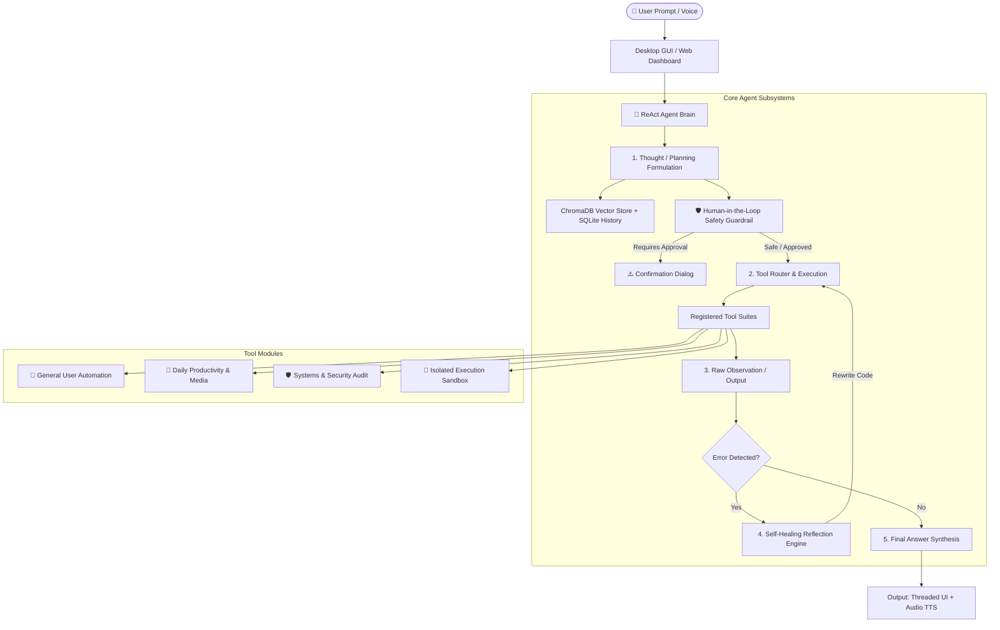

# ⚡ Agentic AI Desktop Workstation & Autonomous Copilot

> **An Elite, Modular, Production-Grade Agentic AI Workstation in Python** featuring an autonomous **ReAct (Reasoning + Acting) Engine**, a **Self-Healing Execution Sandbox**, **ChromaDB Vector Memory**, **Human-in-the-Loop Safety Guardrails**, **Voice Layer (STT/TTS)**, a **Modern CustomTkinter GUI**, and a **FastAPI Real-Time Web Dashboard (`localhost:5000`)**.

---

## 🚀 Download & Run (Standalone Windows Executable)

For everyday and non-technical users who do not have Python or a developer environment installed:

1. Go to the **[Releases](https://github.com/your-username/your-repo/releases)** page of this GitHub repository.
2. Under the latest release tag (e.g. `v1.0.0`), download **`AgenticAI.exe`**.
3. **Double-click `AgenticAI.exe`** on any Windows 10/11 machine to instantly launch the full Agentic AI Desktop Workstation.
   - *No Python installation required.*
   - *No terminal or console commands needed.*
   - *All AI brains, voice synthesis, ChromaDB storage, and tool suites are self-contained.*

---

## 🎯 Executive Summary (The 30-Second Pitch)

Traditional AI assistants are passive conversational interfaces constrained to text responses. **Agentic AI Workstation** is an autonomous desktop copilot designed to bridge everyday non-technical user productivity with technical systems diagnostics and cyber security audits. 

Built with an autonomous **ReAct decision loop**, the agent can formulate thoughts, select and chain tools, inspect runtime feedback, catch and repair broken Python code on the fly (self-healing), and execute multi-step workflows while keeping dangerous operations safeguarded via human confirmation modals.

---

## 🏗️ System Architecture



---

## 🌟 Comprehensive Feature Matrix

### 1. 📱 Everyday User Productivity (A to Z)
| Feature | Implementation | Description |
| :--- | :--- | :--- |
| **QR Code Generator** | `qrcode` + `Pillow` | Generates high-res QR codes for URLs, WiFi credentials, UPI payments, and raw text. |
| **Live Global Weather** | `requests` (wttr API) | Live weather conditions, temperature (°C/°F), humidity, wind speed for any global city. |
| **Currency & Unit Converter** | Mathematics & conversion rates | Converts USD, INR, EUR, GBP, Celsius/Fahrenheit, storage units (MB/GB), and distances. |
| **Todo & Task Reminder** | SQLite Relational DB | Persistent task tracking with priorities (High/Medium/Low) and status flags. |
| **Document & Email Drafter** | Algorithmic Templating | Automatically drafts formal leave applications, resumes, job cover letters, and client updates. |
| **PDF Extraction & Merging** | `pypdf` | Extracts text, counts pages, extracts metadata, and merges multiple PDF files. |
| **Image Conversion & Resizing** | `Pillow` (PIL) | Converts formats (PNG/JPG/WEBP) and resizes image dimensions with aspect ratio preservation. |
| **Storage Cleaner & Temp Purger**| `os.walk` + `tempfile` | Identifies space-hogging files (>100MB) and scans cache to calculate reclaimable storage. |

### 2. 🛡️ Technical Diagnostics & Cyber Security
| Feature | Implementation | Description |
| :--- | :--- | :--- |
| **Live Telemetry Bar** | `psutil` + Threads | Real-time monitoring of CPU load %, RAM usage %, disk partitions, and battery metrics. |
| **Web Security Header Audit** | `requests` + Header parsing | Audits CSP, HSTS, X-Frame-Options, X-Content-Type, and assigns a security letter grade. |
| **Service Reachability / Port Scan**| `socket` with timeouts | Scans open TCP socket ports (80, 443, 22, 3306, 8080) and performs banner grabbing. |
| **Log Anomaly Analyzer** | Regex & stream parsing | Scans server/system logs for error frequencies, warnings, and failure spikes. |
| **Cryptographic Checksums** | `hashlib` | Computes SHA-256, MD5, and SHA-1 hashes for binary file integrity verification. |

### 3. 🐍 Self-Healing Python Sandbox
- **Isolated Execution:** Runs arbitrary Python scripts in a sandboxed subprocess with timeout guardrails.
- **Traceback Reflection:** If a `SyntaxError`, `ModuleNotFoundError`, or runtime exception occurs, the ReAct brain parses the stack trace, auto-injects missing dependencies or syntax fixes, and re-executes automatically.

### 4. 🎙️ Voice Interaction & Accessibility
- **Speech-to-Text (STT):** Microphone audio capture with dynamic ambient noise suppression via `SpeechRecognition`.
- **Offline Text-to-Speech (TTS):** Non-blocking speech synthesis using `pyttsx3` running on an isolated worker thread.

---

## 💡 Key Code Snippets for Technical Walkthroughs

### 1. The Autonomous ReAct Cycle (`core/agent_brain.py`)
```python
def execute_react_cycle(self, user_query: str, max_iterations: int = 5) -> str:
    # 1. Query Long-Term Vector Memory for context
    semantic_memories = self.memory.semantic_search(user_query, n_results=2)
    context_history = []
    
    for iteration in range(max_iterations):
        # 2. Formulate Thought and Select Tool
        thought, plan = self._reason_next_step(user_query, context_history, iteration)
        self.emit_step("thought", thought)
        
        if plan.get("action") == "final_answer":
            return plan.get("answer", thought)

        tool_name = plan.get("tool")
        tool_args = plan.get("arguments", {})

        # 3. Human-in-the-Loop Safety Check
        allowed, reason = self.safety.request_permission(tool_name, tool_args)
        if not allowed:
            context_history.append({"observation": f"Blocked: {reason}"})
            continue

        # 4. Execute Tool & Capture Observation
        obs = self.tools_registry[tool_name]["func"](**tool_args)
        self.emit_step("observation", obs)

        # 5. Self-Healing Trigger on Runtime Errors
        if tool_name == "execute_python_code" and obs.get("needs_healing"):
            healed_code = self._self_heal_code(obs["raw_code"], obs["stderr"])
            obs = self.sandbox_runner.execute_python_code(healed_code)
            
        context_history.append({"tool": tool_name, "observation": obs})
```

### 2. Self-Healing Code Reflection (`core/agent_brain.py`)
```python
def _self_heal_code(self, broken_code: str, error_trace: str) -> str:
    fixed = broken_code
    # Fix Syntax Errors (e.g., Python 2 print statements, missing colons)
    if "SyntaxError" in error_trace:
        fixed = re.sub(r"print\s+(.*)", r"print(\1)", fixed)
    
    # Auto-resolve missing standard library imports
    if "NameError" in error_trace or "ModuleNotFoundError" in error_trace:
        for mod in ["math", "os", "sys", "json", "time", "random"]:
            if mod in error_trace and f"import {mod}" not in fixed:
                fixed = f"import {mod}\n" + fixed

    # Fallback to structured exception wrapper
    if fixed == broken_code:
        fixed = f"try:\n    {broken_code}\nexcept Exception as e:\n    print(f'Recovered: {e}')"
    return fixed
```

### 4. Application Bootstrap & Main Entry Point (`main.py`)
```python
"""Entry Point for Agentic AI Desktop Application.
Initializes directory structures, creates sample test files, mounts subsystems,
and boots the CustomTkinter desktop interface.
"""
import os
import sys
from rich.console import Console
from rich.panel import Panel
from rich.table import Table

console = Console()

def setup_environment():
    """Ensures required data directories and sample playground files exist."""
    required_dirs = [
        "./data", "./data/memory", "./data/notes",
        "./data/sandbox", "./data/sample_files"
    ]
    for d in required_dirs:
        os.makedirs(os.path.abspath(d), exist_ok=True)

    # Initialize sample log file for instant diagnostic testing
    sample_log = os.path.abspath("./data/sample.log")
    if not os.path.exists(sample_log):
        with open(sample_log, "w", encoding="utf-8") as f:
            f.write("2026-09-28 10:00:01 [INFO] System boot sequence completed.\n"
                    "2026-09-28 10:05:30 [ERROR] Connection failed to database shard-02.\n")

def print_banner():
    """Prints a structured banner to console using Rich."""
    table = Table(title="🚀 Agentic AI Desktop Workstation Initialized", border_style="bright_blue")
    table.add_column("Subsystem", style="cyan")
    table.add_column("Status", style="green")
    table.add_column("Details", style="magenta")
    table.add_row("GUI Engine", "Active", "CustomTkinter Dark Theme (1100x780)")
    table.add_row("ReAct Brain", "Active", "Multi-step Reasoning & Tool Router")
    table.add_row("Vector Memory", "Active", "Local ChromaDB & SQLite Persistence")
    console.print(table)

def main():
    """Application entry point: bootstraps environment and launches GUI."""
    setup_environment()
    print_banner()

    # Mounts ReAct Brain, ChromaDB, Safety Guard, and starts Asynchronous UI
    from ui.dashboard import AgentDashboardApp
    app = AgentDashboardApp()
    app.mainloop()

if __name__ == "__main__":
    main()
```

---

## 📂 Project Directory Structure

```
Agentic_AI_Workstation/
│
├── requirements.txt         # Core dependencies
├── main.py                  # Environment bootstrap & CustomTkinter launcher
├── web_server.py            # FastAPI localhost web workstation (port 5000)
│
├── core/
│   ├── __init__.py          # Core package exports
│   ├── agent_brain.py       # ReAct reasoning loop & tool router
│   ├── memory_manager.py    # Local ChromaDB vector database & SQLite history
│   └── safety_guard.py      # Human-in-the-loop risk classification engine
│
├── tools/
│   ├── __init__.py          # Tools registry exports
│   ├── general_tools.py     # File organizer, duplicate scanner, web research, notes
│   ├── productivity_tools.py# QR codes, weather, currency, todos, PDFs, email drafter
│   ├── diagnostic_tools.py  # System health, port reachability, web headers, logs
│   └── sandbox_runner.py    # Isolated subprocess sandbox with traceback analysis
│
├── voice/
│   ├── __init__.py          # Voice package exports
│   └── voice_engine.py      # Non-blocking STT mic listener & offline TTS worker
│
└── ui/
    ├── __init__.py          # UI package exports
    ├── components.py        # Dark theme tokens, Chat bubbles, Metric cards, Modal
    └── dashboard.py         # Asynchronous CustomTkinter desktop window
```

---

## 🚀 Quickstart & Setup

### Prerequisites
- Python 3.10, 3.11, or 3.12 (64-bit)

### Installation
```bash
# 1. Clone or navigate to the workspace
cd "c:\Users\hp\Downloads\Agentic Ai"

# 2. Install all required dependencies
py -m pip install -r requirements.txt
```

### Running the Application

1. **Native Desktop GUI Application (CustomTkinter):**
   ```bash
   py main.py
   ```

2. **Localhost Web Dashboard (Browser Access):**
   ```bash
   py web_server.py
   ```
   *Open your browser and navigate to: **`http://localhost:5000`***

---

## 🏆 Interview Cheat Sheet (HR & Technical Q&A)

### Q1: What is the core problem this project solves?
> **Answer:** "Most AI assistants today are passive chatbots that can only return text. If you ask them to organize your files, check system performance, or test a script, they cannot interact with the operating system. I built an **Agentic AI System** with an autonomous ReAct reasoning loop that can plan, call local tools, observe outcomes, self-correct errors, and execute tasks directly on the desktop with human safety guardrails."

### Q2: How did you ensure the UI remains responsive during long-running tasks?
> **Answer:** "I implemented a **multi-threaded asynchronous queue architecture**. The CustomTkinter UI and FastAPI server run on their respective main threads, while the ReAct agent, voice engine, and telemetry monitors run on decoupled background worker threads. Telemetry and agent step updates communicate with the UI via a thread-safe `queue.Queue()`, preventing GUI freezing or deadlocks."

### Q3: How does the Self-Healing mechanism work?
> **Answer:** "When the agent generates and executes Python code in the sandbox subprocess, the runner captures both `stdout` and `stderr`. If an exception occurs (such as a `SyntaxError` or `ModuleNotFoundError`), the runner flags `needs_healing: True`. The ReAct engine inspects the stack trace, infers the missing dependency or syntax correction, modifies the code, and re-executes it automatically."

### Q4: How is safety handled for destructive actions?
> **Answer:** "I implemented a **Human-in-the-Loop Safety Guardrail** (`safety_guard.py`). Every tool request is classified into risk levels (SAFE, LOW, MEDIUM, HIGH, CRITICAL). If an action involves file deletion or process termination, the background agent thread pauses using a `threading.Event()` synchronization lock and triggers an approval modal dialog in the UI. The action is executed only if explicitly approved by the user."

---

## 📜 License
Open-source under the MIT License. Developed for advanced agentic software systems engineering.
